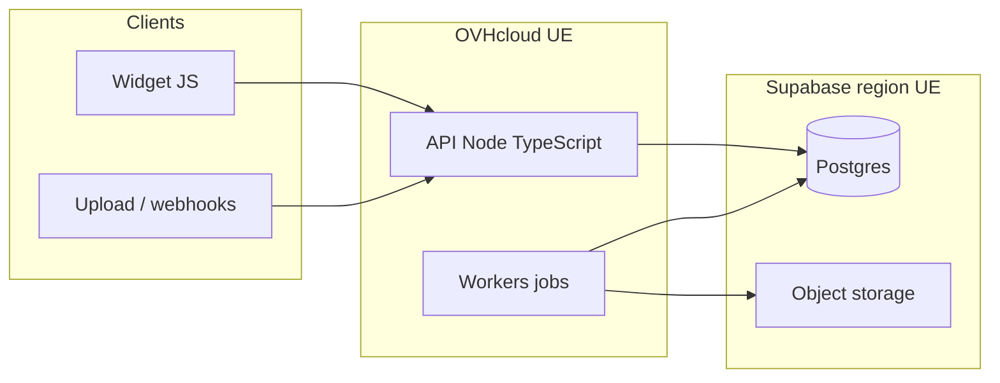

# Phase 0 — Cadrage technique

**Produit :** Kanso Solutions (SHBT-STUDIO SAS)  
**Date :** 2026-10-10  
**Statut :** décisions de cadrage figées pour démarrer la phase 1

## Objectif

Choisir le langage, l’organisation des dépôts, l’hébergement UE, l’enveloppe infra et le socle d’outils déjà maîtrisés, afin de fonder les phases suivantes sans sur-ingénierie.

## Décisions retenues

| Sujet                       | Choix                                                | Source          |
| --------------------------- | ---------------------------------------------------- | --------------- |
| Langage / runtime           | TypeScript (Node.js)                                 | Q1 = 1          |
| Organisation Git            | Mono-dépôt                                           | Q2 = 1          |
| Hébergeur compute           | OVHcloud (région UE)                                 | Q3 = 2          |
| Budget infra hors tokens IA | &lt; 50 € / mois                                     | Q4 = 1          |
| Outils maîtrisés            | GitHub Actions, Docker / Compose, Postgres, Supabase | Q5 = A, B, C, F |

## Architecture cible (rôles clairs)

Pas de « tout OVH » ni « tout Supabase » : chaque fournisseur a un rôle pour tenir le budget.

| Couche              | Choix                                       | Rôle                                                             |
| ------------------- | ------------------------------------------- | ---------------------------------------------------------------- |
| Runtime             | 1 petite instance OVH + Docker Compose      | API Inbound + worker Document-to-Action                          |
| Données             | Supabase (région UE)                        | Postgres multi-tenant ; object storage documents si besoin       |
| Secrets applicatifs | Environnement / secret store sur l’hôte OVH | Jamais dans Git ; secrets par `tenant_id` (détail phases 1 et 6) |
| CI                  | GitHub Actions                              | Lint, typecheck, tests — pas de CD complexe en phase 0           |
| File de jobs        | Table Postgres + worker polling             | Pas de Redis au MVP                                              |
| Modèles IA          | Couche d’abstraction provider               | Aucun modèle figé dans l’architecture                            |

## Justifications

1. **TypeScript** — un seul langage pour le widget, l’API, les adaptateurs et les workers ; adapté à une équipe de 4 personnes.
2. **Mono-dépôt** — packages partagés (`config`, `llm`, `adapters`, `tenancy`) pour « Write Once, Deploy Many » sans synchroniser deux repos.
3. **OVHcloud** — compute en UE, discours commercial FR/UE cohérent avec le positionnement TPE/PME.
4. **Supabase UE** — Postgres et tooling déjà maîtrisés ; évite un Postgres managé OVH plus coûteux au démarrage.
5. **Budget &lt; 50 € / mois** — cible : offre Supabase free ou pro léger + 1 VPS OVH entrée de gamme + monitoring minimal. Les tokens LLM restent hors enveloppe (poste variable).

## Vérification modèles IA (2026-10-10)

Sources publiques consultées (docs fournisseurs / listes modèles). Liste non figée ; à revalider via les endpoints `models` des comptes au moment du choix produit.

| Fournisseur | Constat documentaire (non exhaustif)                                                                                                   |
| ----------- | -------------------------------------------------------------------------------------------------------------------------------------- |
| OpenAI      | Familles documentées notamment GPT-6 Astra, GPT-6.1 Sol, GPT-6 Luna, GPT-5.6 ; snapshots GPT-5 historiques en dépréciation progressive |
| Anthropic   | Release notes / docs mentionnent notamment Claude Opus 5, Opus/Sonnet 4.6, Haiku 4.5                                                   |
| Mistral     | Endpoint régional `https://api.eu.mistral.ai` ; modèles documentés notamment Large 4, Medium 3.5, Small 4, Ministral 3, OCR            |

**Règle :** le code parle à une interface Kanso (`LlmClient`) ; le choix de modèle est configuration + évaluation (phases 3, 5, 8), pas une constante d’architecture.

## Hors périmètre de cette phase

- Schémas de configuration client (phase 2)
- Machine à états Inbound (phase 3)
- Contrats d’adaptateurs (phase 4)
- Pipeline Document-to-Action détaillé (phase 5)
- Checklist RGPD / exploitation complète (phase 6)
- Code applicatif (phase 7+)

## Hypothèses à vérifier

- [ ] Tarif réel OVH (instance + IP + snapshots + bande passante) dans le reste de budget après Supabase
- [ ] Région UE exacte du projet Supabase, localisation des backups, DPA signable
- [ ] Suffisance du free tier (ou pro léger) Supabase pour N tenants + stockage documents
- [ ] Engagement contractuel « traitement / inférence UE » des fournisseurs LLM retenus pour le pilote
- [ ] Qualité d’extraction multimodale via APIs cloud en TypeScript suffisante sans stack ML Python local

## Ce qui reste incertain

- Région Supabase exacte et portée du DPA
- Prix OVH sous enveloppe &lt; 50 € une fois Supabase choisi
- Limites free tier vs premiers clients pilotes
- Localisation réelle du traitement LLM hors endpoint Mistral EU

## Risques

| Risque                                                  | Impact                             | Mitigation initiale                                    |
| ------------------------------------------------------- | ---------------------------------- | ------------------------------------------------------ |
| Budget &lt; 50 € dépassé (egress, storage, 2e instance) | Coupure ou dette                   | Une seule instance ; storage limité ; alertes coût     |
| Deux fournisseurs (OVH + Supabase)                      | Deux DPA, deux surfaces d’incident | Rôles documentés ; inventaire traitements (phase 6)    |
| Pas de Redis                                            | Contention jobs si volume docs     | Postgres jobs OK au MVP ; réévaluation si file saturée |
| Sur-investissement avant premier client                 | Burn runway                        | Périmètre minimal ; pas de HA en phase 0               |

## Critère de passage phase 1

Phase 0 considérée prête pour la structure du dépôt dès validation explicite du présent livrable (ou amendements mineurs déjà intégrés).
