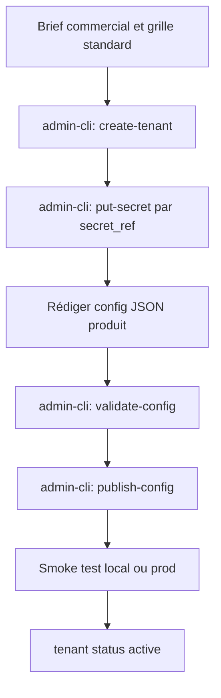

# Phase 2 — Configuration client

**Produit :** Kanso Solutions (SHBT-STUDIO SAS)  
**Date :** 2026-10-10  
**Statut :** validé (2026-10-10)  
**Prérequis :** [phase-1-structure-depot.md](./phase-1-structure-depot.md)

## Objectif

Figer le contrat de configuration de chaque produit (champs, validation, versionnement), illustrer avec un cabinet d’avocats et une PME BTP, et décrire l’instanciation d’un nouveau client — sans code (implémentation Zod en phase 7).

## Décisions retenues

| Sujet                              | Choix                                                                                                                                | Source             |
| ---------------------------------- | ------------------------------------------------------------------------------------------------------------------------------------ | ------------------ |
| Format schéma                      | Zod source de vérité ; JSON Schema exporté                                                                                           | Q1 = 1             |
| Granularité                        | Un document JSON versionné **par produit**                                                                                           | Q2 = 1             |
| Publication prod                   | Associé Kanso via `admin-cli` uniquement                                                                                             | Q3 = 1             |
| Inbound MVP obligatoire            | Identité/disclaimer, qualification+scoring, alertes, horaires/langues/escalade                                                       | Q4 = A,B,E,F       |
| Document-to-Action MVP obligatoire | Sources, types+champs, règles validation, cible brouillon, alertes confiance                                                         | Q5 = A,B,C,D,E     |
| Hors schéma tenant MVP             | Agenda (C) et CRM (D) Inbound : **optionnels typés** ; conservation docs (F) : **politique globale Kanso** (phase 6), pas par client | Découlant de Q4/Q5 |

## Modèle de versionnement

Stockage Supabase (conceptuel) :

| Table            | Rôle                                                                                                                                                                                               |
| ---------------- | -------------------------------------------------------------------------------------------------------------------------------------------------------------------------------------------------- |
| `tenants`        | `tenant_id`, nom commercial, statut (`draft` \| `active` \| `suspended`)                                                                                                                           |
| `tenant_configs` | `tenant_id`, `product` (`inbound` \| `document_to_action`), `version` (int), `schema_version` (semver schéma), `config` (JSONB), `status` (`draft` \| `published`), `published_at`, `published_by` |
| `tenant_secrets` | références chiffrées par `tenant_id` + clé logique (`slack_webhook`, `pennylane_api_key`, …)                                                                                                       |

Règles :

1. Une seule version `published` active par couple `(tenant_id, product)`.
2. Publier = valider Zod → écrire nouvelle `version` → basculer `published` (l’ancienne passe en historique).
3. Rollback = republier une version antérieure (nouvelle ligne avec `version` incrémentée, contenu restauré) pour audit.
4. Les secrets ne sont **jamais** dans `config` JSON ; seulement des `secret_ref` (ex. `"slack_webhook": { "secret_ref": "alerts.slack_webhook" }`).
5. `schema_version` du document doit être supportée par le runtime déployé ; sinon refus de publication.

## Schéma Inbound (`product = inbound`)

Source de vérité cible : `packages/config` → `InboundConfig` (Zod). Ci-dessous le contrat documentaire v1.

### Champs

| Chemin                               | Type                                                                      | Obligatoire | Notes                                                    |
| ------------------------------------ | ------------------------------------------------------------------------- | ----------- | -------------------------------------------------------- |
| `schema_version`                     | string semver                                                             | oui         | ex. `"1.0.0"`                                            |
| `product`                            | `"inbound"`                                                               | oui         | littéral                                                 |
| `identity.display_name`              | string                                                                    | oui         | nom affiché widget                                       |
| `identity.locale_default`            | `"fr"` \| `"en"`                                                          | oui         | MVP : `fr` recommandé                                    |
| `identity.branding.primary_color`    | string hex                                                                | oui         | marque blanche légère                                    |
| `identity.branding.logo_url`         | string url \| null                                                        | non         |                                                          |
| `disclosure.ai_notice`               | string                                                                    | oui         | texte visible : parlons à une IA                         |
| `disclosure.forbidden_topics`        | string[]                                                                  | oui         | min. juridique/comptable selon produit ; refus explicite |
| `qualification.questions[]`          | array                                                                     | oui         | min 1                                                    |
| `qualification.questions[].id`       | string slug                                                               | oui         |                                                          |
| `qualification.questions[].prompt`   | string                                                                    | oui         |                                                          |
| `qualification.questions[].type`     | `single_choice` \| `multi_choice` \| `free_text` \| `number` \| `boolean` | oui         |                                                          |
| `qualification.questions[].options`  | `{id,label}[]`                                                            | si choice   |                                                          |
| `qualification.questions[].required` | boolean                                                                   | oui         |                                                          |
| `scoring.weights`                    | record `question_id` → règles                                             | oui         | voir ci-dessous                                          |
| `scoring.max_score`                  | `100`                                                                     | oui         | littéral MVP                                             |
| `scoring.thresholds`                 | `{ hot, warm, cold }` nombres                                             | oui         | bornes sur score /100                                    |
| `alerts.channels[]`                  | array                                                                     | oui         | min 1                                                    |
| `alerts.channels[].type`             | `email` \| `slack`                                                        | oui         |                                                          |
| `alerts.channels[].secret_ref`       | string                                                                    | oui         | pointeur secret                                          |
| `alerts.on`                          | `new_lead` \| `hot_lead` \| `escalation` \| `handoff`                     | oui         | événements                                               |
| `operations.timezone`                | string IANA                                                               | oui         | ex. `Europe/Paris`                                       |
| `operations.business_hours`          | créneaux par jour                                                         | oui         | hors créneaux → message + capture contact                |
| `operations.languages`               | string[]                                                                  | oui         |                                                          |
| `operations.escalation`              | objet                                                                     | oui         | mots-clés / demande humaine → alerte + fin contrôlée     |
| `integrations.calendar`              | objet \| absent                                                           | non         | si présent : `provider` + `secret_ref` + mapping         |
| `integrations.crm`                   | objet \| absent                                                           | non         | si présent : `provider` + `secret_ref` + field_mapping   |

### Scoring (contrat)

Chaque réponse contribue 0–N points. Somme plafonnée à 100.

```text
weights[question_id] =
  | { kind: "choice_map", points: { option_id: number } }
  | { kind: "boolean", true_points, false_points }
  | { kind: "number_range", ranges: [{ min, max, points }] }
  | { kind: "free_text", points_if_non_empty }   # pas d’analyse sémantique au MVP
```

Engagement produit : score = **indicateur de qualification configuré**, pas une promesse de conversion (_moyens, pas résultat_).

### Validations à l’publication

- Disclaimer IA non vide ; `forbidden_topics` contient au minimum les entrées Kanso par défaut (juridique, comptable) — surcharge client possible en ajout, pas en suppression des défauts système (_hypothèse à vérifier_ en phase 3 garde-fous).
- Au moins un canal d’alerte résolu (secret existant).
- Si `integrations.calendar` ou `integrations.crm` présents → provider dans la liste supportée + `secret_ref` valide.
- `hot >= warm >= cold` et valeurs dans `[0,100]`.

---

## Schéma Document-to-Action (`product = document_to_action`)

### Champs

| Chemin                               | Type                                                                                                   | Obligatoire | Notes                                                      |
| ------------------------------------ | ------------------------------------------------------------------------------------------------------ | ----------- | ---------------------------------------------------------- |
| `schema_version`                     | string semver                                                                                          | oui         | `"1.0.0"`                                                  |
| `product`                            | `"document_to_action"`                                                                                 | oui         |                                                            |
| `sources[]`                          | array                                                                                                  | oui         | min 1                                                      |
| `sources[].type`                     | `email_inbox` \| `upload_web` \| `google_drive` \| `dropbox`                                           | oui         | MVP peut n’implémenter qu’un sous-ensemble (phase 4/5)     |
| `sources[].secret_ref`               | string                                                                                                 | selon type  | mail / drive                                               |
| `sources[].options`                  | objet                                                                                                  | non         | ex. dossier Drive, filtre objet mail                       |
| `documents.accepted_types[]`         | `invoice` \| `quote` \| `delivery_note`                                                                | oui         |                                                            |
| `documents.fields_by_type`           | map type → `field_id[]`                                                                                | oui         | champs à extraire                                          |
| `validation.rules[]`                 | array                                                                                                  | oui         | min 1                                                      |
| `validation.rules[].id`              | string                                                                                                 | oui         |                                                            |
| `validation.rules[].kind`            | `totals_coherent` \| `duplicate_check` \| `iban_allowlist` \| `approval_threshold` \| `confidence_min` | oui         |                                                            |
| `validation.rules[].params`          | objet                                                                                                  | selon kind  | ex. seuil €, liste `secret_ref` IBAN                       |
| `action.target.provider`             | string                                                                                                 | oui         | ex. `pennylane`, `sellsy`, `notion`, `webhook`             |
| `action.target.secret_ref`           | string                                                                                                 | oui         |                                                            |
| `action.mode`                        | `"draft"` \| `"final"`                                                                                 | oui         | défaut schéma / runtime : `"draft"`                        |
| `action.on_failure`                  | `"queue_anomaly"`                                                                                      | oui         | littéral MVP                                               |
| `alerts.human_review`                | objet                                                                                                  | oui         | seuils confiance + canaux (`email`/`slack` + `secret_ref`) |
| `alerts.human_review.min_confidence` | number 0–1                                                                                             | oui         | sous le seuil → anomalie + alerte                          |
| `alerts.human_review.channels[]`     | array                                                                                                  | oui         |                                                            |

**Non inclus dans le schéma tenant MVP (Q5 sans F) :** durées de conservation fichiers/audit → politique globale Kanso (phase 6), pas configurable client au v1.

### Validations à l’publication

- Au moins une source et un type de document.
- Chaque `accepted_type` a une liste de champs non vide.
- `action.mode` défaut recommandé `"draft"` ; `"final"` exige confirmation explicite dans `admin-cli` (_garde-fou process_).
- Règle `duplicate_check` : stratégie `content_hash` et/ou `provider_external_id` (_détail phase 5_).

---

## Exemple 1 — Cabinet d’avocats (Inbound seul)

`tenant_id` : `cabinet-durand`  
Produit publié : `inbound` uniquement.

```json
{
  "schema_version": "1.0.0",
  "product": "inbound",
  "identity": {
    "display_name": "Cabinet Durand",
    "locale_default": "fr",
    "branding": {
      "primary_color": "#1B2A4A",
      "logo_url": null
    }
  },
  "disclosure": {
    "ai_notice": "Vous échangez avec un assistant automatisé du Cabinet Durand. Ce n’est pas un avocat et cela ne constitue pas un conseil juridique.",
    "forbidden_topics": [
      "conseil_juridique",
      "conseil_comptable",
      "diagnostic_medical"
    ]
  },
  "qualification": {
    "questions": [
      {
        "id": "matter_type",
        "prompt": "Quel est le domaine de votre demande ?",
        "type": "single_choice",
        "required": true,
        "options": [
          { "id": "corporate", "label": "Droit des sociétés" },
          { "id": "labor", "label": "Droit social" },
          { "id": "other", "label": "Autre" }
        ]
      },
      {
        "id": "urgency",
        "prompt": "Sous quel délai souhaitez-vous un premier échange ?",
        "type": "single_choice",
        "required": true,
        "options": [
          { "id": "48h", "label": "Sous 48 h" },
          { "id": "week", "label": "Sous 7 jours" },
          { "id": "flex", "label": "Flexible" }
        ]
      },
      {
        "id": "company_size",
        "prompt": "Effectif approximatif de votre structure ?",
        "type": "single_choice",
        "required": false,
        "options": [
          { "id": "1_10", "label": "1–10" },
          { "id": "11_50", "label": "11–50" },
          { "id": "50_plus", "label": "50+" }
        ]
      },
      {
        "id": "contact_email",
        "prompt": "Votre e-mail professionnel ?",
        "type": "free_text",
        "required": true
      }
    ]
  },
  "scoring": {
    "max_score": 100,
    "thresholds": { "hot": 70, "warm": 40, "cold": 0 },
    "weights": {
      "matter_type": {
        "kind": "choice_map",
        "points": { "corporate": 35, "labor": 30, "other": 10 }
      },
      "urgency": {
        "kind": "choice_map",
        "points": { "48h": 35, "week": 20, "flex": 10 }
      },
      "company_size": {
        "kind": "choice_map",
        "points": { "1_10": 10, "11_50": 20, "50_plus": 25 }
      },
      "contact_email": { "kind": "free_text", "points_if_non_empty": 5 }
    }
  },
  "alerts": {
    "channels": [
      {
        "type": "email",
        "secret_ref": "alerts.intake_email",
        "on": ["hot_lead", "escalation", "handoff"]
      }
    ]
  },
  "operations": {
    "timezone": "Europe/Paris",
    "languages": ["fr"],
    "business_hours": {
      "mon": [
        ["09:00", "12:30"],
        ["14:00", "18:00"]
      ],
      "tue": [
        ["09:00", "12:30"],
        ["14:00", "18:00"]
      ],
      "wed": [
        ["09:00", "12:30"],
        ["14:00", "18:00"]
      ],
      "thu": [
        ["09:00", "12:30"],
        ["14:00", "18:00"]
      ],
      "fri": [
        ["09:00", "12:30"],
        ["14:00", "17:00"]
      ],
      "sat": [],
      "sun": []
    },
    "escalation": {
      "user_requests_human": true,
      "keywords": ["parler à un avocat", "urgence vitale"],
      "message": "Je transmets votre demande à l’équipe. Un collaborateur vous recontactera."
    }
  }
}
```

Pas d’`integrations.calendar` / `crm` dans cet exemple : alerte e-mail + score suffisent pour un premier pilote.

---

## Exemple 2 — PME BTP (Document-to-Action + Inbound optionnel)

`tenant_id` : `btp-leroy`  
Produits : `document_to_action` publié ; `inbound` peut être ajouté plus tard (document séparé).

```json
{
  "schema_version": "1.0.0",
  "product": "document_to_action",
  "sources": [
    {
      "type": "email_inbox",
      "secret_ref": "sources.ingest_mailbox",
      "options": { "folder": "INBOX", "subject_prefix": "[FACTURE]" }
    },
    {
      "type": "upload_web",
      "options": { "max_size_mb": 15 }
    }
  ],
  "documents": {
    "accepted_types": ["invoice", "quote", "delivery_note"],
    "fields_by_type": {
      "invoice": [
        "vendor_name",
        "invoice_number",
        "invoice_date",
        "currency",
        "total_ht",
        "total_ttc",
        "vat_amount",
        "iban",
        "due_date"
      ],
      "quote": [
        "vendor_name",
        "quote_number",
        "quote_date",
        "total_ht",
        "total_ttc",
        "validity_date"
      ],
      "delivery_note": [
        "vendor_name",
        "delivery_number",
        "delivery_date",
        "site_reference",
        "line_items_count"
      ]
    }
  },
  "validation": {
    "rules": [
      {
        "id": "totals",
        "kind": "totals_coherent",
        "params": { "tolerance_eur": 0.05 }
      },
      {
        "id": "dup",
        "kind": "duplicate_check",
        "params": { "keys": ["vendor_name", "invoice_number"] }
      },
      {
        "id": "iban",
        "kind": "iban_allowlist",
        "params": { "secret_ref": "validation.known_ibans" }
      },
      {
        "id": "approval",
        "kind": "approval_threshold",
        "params": { "amount_field": "total_ttc", "max_auto_draft_eur": 2000 }
      },
      {
        "id": "confidence",
        "kind": "confidence_min",
        "params": { "min": 0.85 }
      }
    ]
  },
  "action": {
    "target": {
      "provider": "pennylane",
      "secret_ref": "targets.pennylane"
    },
    "mode": "draft",
    "on_failure": "queue_anomaly"
  },
  "alerts": {
    "human_review": {
      "min_confidence": 0.85,
      "channels": [
        {
          "type": "slack",
          "secret_ref": "alerts.ops_slack",
          "on": ["low_confidence", "validation_failed", "duplicate_suspected"]
        }
      ]
    }
  }
}
```

---

## Processus d’instanciation d’un nouveau client



Étapes (associés Kanso uniquement) :

1. **Brief** — besoins, produits vendus, canaux d’alerte, outils cibles (hors engagement de résultat).
2. **`create-tenant`** — `tenant_id` slug, nom, statut `draft`.
3. **Secrets** — enregistrer chaque `secret_ref` (Vault / colonne chiffrée) ; jamais dans le JSON de config.
4. **Draft config** — partir d’un exemple (`config/examples/…`) ; adapter questions / règles.
5. **`validate-config`** — Zod + présence des secrets référencés.
6. **`publish-config`** — nouvelle `version` `published` pour le produit.
7. **Smoke** — Inbound : une conversation test ; Document-to-Action : un document anonymisé en brouillon.
8. **`activate-tenant`** — widget / adresse d’ingestion communiqués au client.
9. **Change request** — le client envoie un brief ; Kanso republie via CLI (pas de back-office client au MVP).

Durée cible process (_hypothèse à vérifier_) : &lt; 1 journée associée pour un client grille standard sans connecteur exotique.

---

## Fichiers exemples prévus dans le repo (phase 7)

```text
config/examples/
  inbound.avocats.example.json
  document_to_action.btp.example.json
config/schemas/
  inbound.v1.json          # export JSON Schema depuis Zod
  document_to_action.v1.json
```

## Hors périmètre

- Comportement runtime machine à états (phase 3)
- Liste ordonnée des connecteurs et contrats d’erreurs (phase 4)
- Détail file d’anomalies / audit (phase 5)
- Durées de conservation et journal des traitements (phase 6)
- Implémentation Zod / CLI (phase 7)

## Ce qui reste incertain

- Sous-ensemble exact de `sources[].type` et `action.target.provider` livrés au premier pilote (phase 4)
- Liste figée des `forbidden_topics` système non supprimables
- Stratégie anti-doublon définitive (`content_hash` vs clés métier)
- Confirmation process : `"final"` interdit en self-serve — CLI seulement avec flag explicite

## Risques

| Risque                                | Impact                  | Mitigation                                                       |
| ------------------------------------- | ----------------------- | ---------------------------------------------------------------- |
| Schéma trop riche trop tôt            | Retard livrable         | Champs optionnels agenda/CRM ; un produit à la fois              |
| Publication CLI seule                 | Goulot associés         | Acceptable pré-CA ; documenter SLA interne de mise à jour config |
| Conservation absente du schéma client | Oubli RGPD              | Politique globale obligatoire en phase 6                         |
| Score mal calibré                     | Fausses alertes « hot » | Exemples + phase 8 évaluation conversations                      |

## Question de validation

Ce contrat de configuration (schémas, exemples, process CLI) vous convient-il ? Répondez **validé** pour ouvrir la phase 3 (moteur Inbound), ou indiquez les amendements.
