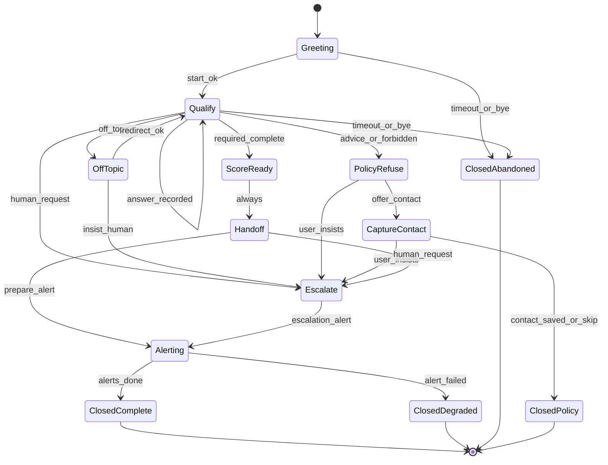

# Phase 3 — Moteur Inbound

**Produit :** Kanso Solutions (shbt studio SAS)  
**Date :** 2026-10-10  
**Statut :** validé (2026-10-10)  
**Prérequis :** [phase-2-configuration-client.md](./phase-2-configuration-client.md)

## Objectif

Spécifier la machine à états hybride, la session Postgres, le scoring runtime, les cas limites et les garde-fous anti-hallucination du moteur Inbound — sans implémentation code (phase 7).

## Décisions retenues

| Sujet | Choix | Source |
|-------|--------|--------|
| Pilotage états | Hybride : code = funnel ; LLM = reformulation + intention dans l’état courant | Q1 = 3 |
| Session | Postgres (`inbound_sessions` + messages), TTL global | Q2 = 1 |
| Scoring | Recalcul à chaque réponse + score figé à la clôture | Q3 = 3 |
| Conseil / hors politique | Refus + capture contact ; escalation si insistance | Q4 = 3 |
| Garde-fous MVP | Sorties structurées + question_id allowlist + pas d’affirmations hors config | Q5 = A,B,C |
| RAG | **Hors MVP** ; prévu ensuite | Q5 complément |

## Principes runtime

1. Le **code** possède l’état (`session.state`) et les transitions autorisées.
2. Le **LLM** produit uniquement un payload validé par schéma Zod runtime (pas de prose libre comme source de vérité).
3. Toute action externe (alerte, CRM, agenda) passe par des **function calls / adapters** déclenchés par le code après transition — pas par le modèle seul.
4. Engagements = **moyens** (répondre, qualifier, alerter) ; jamais promesse de conversion ou de conseil.
5. Disclaimer IA affiché au premier message widget (et rappelé après refus de conseil).

## Diagramme d’états



### États

| État | Rôle | Qui parle |
|------|------|-----------|
| `Greeting` | Accueil + disclaimer IA + langue | Template config (+ LLM reformulation légère optionnelle) |
| `Qualify` | Poser / recueillir les questions de config dans l’ordre métier | Code choisit `question_id` ; LLM formule le message |
| `OffTopic` | Hors sujet non interdit | LLM classe ; code redirige vers question courante |
| `PolicyRefuse` | Demande de conseil juridique/comptable ou topic interdit | Message de refus fixe / semi-fixe ; pas de fond |
| `CaptureContact` | E-mail / téléphone si pas encore capturé | Question `free_text` dédiée ou reprise `contact_*` |
| `ScoreReady` | Toutes les `required` répondues ; score courant = candidat final | Code pur |
| `Handoff` | Synthèse courte + prochaines étapes (sans promesse de résultat) | LLM sous contraintes C |
| `Alerting` | Envoi alertes selon canaux + seuils (`hot_lead`, etc.) | Adapters ; pas de LLM |
| `Escalate` | Demande humaine ou insistance après refus | Alerte `escalation` / `handoff` |
| `ClosedComplete` | Fin nominale après alerte OK | — |
| `ClosedDegraded` | Fin après échec alerte (retry policy phase 4) | — |
| `ClosedAbandoned` | Timeout / au revoir sans qualification complète | Alerte optionnelle `new_lead` si contact partiel (*hypothèse*) |
| `ClosedPolicy` | Fin après refus politique + contact traité | — |

### Transitions (table)

| Depuis | Événement | Vers | Condition |
|--------|-----------|------|-----------|
| `Greeting` | `session.start` | `Qualify` | Toujours après disclaimer |
| `Qualify` | `message.answered` | `Qualify` | Réponse validée ; score courant mis à jour |
| `Qualify` | `intent.off_topic` | `OffTopic` | Intention classée hors sujet |
| `Qualify` | `intent.forbidden` / `intent.advice` | `PolicyRefuse` | Topic interdit ou conseil |
| `Qualify` | `intent.human` | `Escalate` | Demande explicite d’humain |
| `Qualify` | `qualify.complete` | `ScoreReady` | Toutes `required` présentes |
| `Qualify` | `session.timeout` / `intent.bye` | `ClosedAbandoned` | TTL ou adieu |
| `OffTopic` | `redirect.ok` | `Qualify` | Reprise question courante |
| `OffTopic` | `intent.human` | `Escalate` | — |
| `PolicyRefuse` | `refuse.done` | `CaptureContact` | Si contact manquant ; sinon `ClosedPolicy` |
| `PolicyRefuse` | `intent.insist` | `Escalate` | 2e tentative sur le fond interdit |
| `CaptureContact` | `contact.done` | `ClosedPolicy` | — |
| `CaptureContact` | `intent.insist` | `Escalate` | — |
| `ScoreReady` | `score.freeze` | `Handoff` | `score_final` écrit |
| `Handoff` | `handoff.ready` | `Alerting` | — |
| `Handoff` | `intent.human` | `Escalate` | — |
| `Escalate` | `escalate.alert` | `Alerting` | — |
| `Alerting` | `alert.ok` | `ClosedComplete` | — |
| `Alerting` | `alert.fail` | `ClosedDegraded` | Après retries adapter |

États `Closed*` sont terminaux ; nouvelle visite widget = **nouvelle session** (sauf reprise explicite par `session_id` encore actif).

## Session

### Modèle de données (conceptuel)

```text
inbound_sessions
  id, tenant_id, config_version, state
  score_current, score_final (nullable)
  answers jsonb          -- { question_id: value }
  locale, started_at, last_activity_at, closed_at
  close_reason           -- complete|abandoned|policy|degraded|escalated
  metadata jsonb         -- user_agent, utm, etc.

inbound_messages
  id, session_id, role (user|assistant|system)
  content, structured_payload jsonb, created_at
```

### Règles

- TTL d’inactivité **global Kanso** (pas dans la config tenant MVP) — *hypothèse à vérifier* : 30 minutes.
- Chaque message utilisateur met à jour `last_activity_at`.
- `config_version` figée au `session.start` (changement de config publié n’affecte pas la session en cours).
- Isolation : toute requête filtrée par `tenant_id` (phase 6).

## Scoring runtime

1. À chaque `message.answered` valide sur une question scorée : recalcul `score_current` selon `scoring.weights` (phase 2), plafond 100.
2. `score_current` **jamais** affiché au visiteur par défaut (usage interne / alertes).
3. Sur `ScoreReady` : `score_final = score_current` ; immuable ensuite.
4. Seuils `hot` / `warm` / `cold` : déterminent le type d’alerte (`hot_lead` si `score_final >= hot`, etc.).
5. Questions non `required` absentes : 0 point pour leur weight.

## Contrat LLM (dans un état)

Payload de sortie validé (MVP) :

| Champ | Type | Contrainte |
|-------|------|------------|
| `intent` | enum | `answer` \| `off_topic` \| `advice` \| `forbidden` \| `human` \| `bye` \| `insist` \| `other` |
| `answer` | objet \| null | `{ question_id, value }` si `intent=answer` |
| `assistant_message` | string | Texte widget ; pas de faits hors allowlist |
| `claimed_facts` | string[] | Vide au MVP, ou IDs de faits config uniquement |

Règles code **avant** d’accepter le payload :

- **A.** Parse + validation schéma ; sinon retry une fois avec erreur de validation, puis message générique + log.
- **B.** Si `answer.question_id` ≠ question attendue par l’état → rejet ; rester sur la question courante.
- **C.** Détection affirmations sensibles (*hypothèse* : liste de motifs + interdiction modèle dans le prompt système) : prix, délais de rappel, disponibilité avocat, « oui vous avez une affaire » — absents de la config → strip / refus de publier le message, fallback template.

Le prompt système rappelle : pas de conseil juridique/comptable ; topics interdits ; questions allowlist.

## Cas limites

| Cas | Comportement |
|-----|--------------|
| Abandon / timeout | `ClosedAbandoned` ; si e-mail partiel présent → alerte `new_lead` optionnelle (*hypothèse H-013*) |
| Hors sujet | `OffTopic` → message de recentrage → retour `Qualify` |
| Conseil / interdit | `PolicyRefuse` → refus court + rappel disclaimer → `CaptureContact` |
| Insistance après refus | `intent.insist` → `Escalate` + alerte |
| Demande humain | `Escalate` depuis `Qualify` / `Handoff` / `OffTopic` |
| Hors horaires | Toujours accueillir ; message « hors créneaux » ; qualification continue ; alerte avec flag `outside_hours` |
| LLM down / invalide | Message d’excuse template ; pas de transition fantôme ; session reste dans l’état ; métrique erreur |
| Agenda / CRM absents | Handoff textuel + alerte seulement (conformément config phase 2) |
| Agenda / CRM présents | Après `Alerting` ou en parallèle contrôlée — **spec d’appel** en phase 4 ; ordre MVP : alerte d’abord, sync CRM/calendar best-effort |

## Function calling (côté code)

Le moteur expose des *tools* internes déclenchés **par transition**, pas librement par le LLM :

| Tool | Quand |
|------|-------|
| `record_answer` | Transition `Qualify` réussie |
| `recompute_score` | Après `record_answer` |
| `freeze_score` | Entrée `ScoreReady` |
| `send_alert` | État `Alerting` |
| `create_crm_record` | Si `integrations.crm` présent (phase 4) |
| `propose_calendar_slots` | Si `integrations.calendar` présent (phase 4) |

Le LLM **n’appelle pas** ces tools directement au MVP ; il renvoie `intent` + `answer`, le code orchestre.

## RAG (post-MVP)

Hors scope phase 3 livrable runtime :

- Index documents client (FAQ, pages) pour répondre hors questions de qualification.
- Garde-fous additionnels : citations obligatoires, refus si pas de passage source.
- Décision d’activation : config optionnelle future + phase 8 évaluation.

Documenté ici pour éviter le scope creep MVP.

## Hors périmètre

- Contrats d’adapters (erreurs, retry, rate limits) — phase 4  
- Pipeline documents — phase 5  
- TTL exact, rétention messages, chiffrement — phase 6  
- Code / tests e2e conversation — phases 7–8  

## Ce qui reste incertain

- Durée TTL session exacte (hypothèse 30 min)
- Alerte ou non sur abandon avec contact partiel
- Robustesse de la détection C (motifs vs classifieur) sous budget tokens
- Ordre précis CRM vs alerte quand les deux sont configurés (proposé : alerte d’abord)

## Risques

| Risque | Impact | Mitigation |
|--------|--------|------------|
| Intent LLM mal classé | Mauvaise transition | Allowlist états ; question_id imposé ; retry validation |
| Score « hot » trop tôt | Spam alertes | Alertes `hot_lead` sur `score_final` uniquement ; `score_current` interne |
| Refus politique trop dur / trop mou | UX ou non-conformité | Templates fixes + escalation sur insistance |
| Session longue coûteuse | Tokens | Historique tronqué au prompt (N derniers tours) — *hypothèse H-014* |

## Question de validation

Cette machine à états et cette spec runtime vous conviennent-elles ? Répondez **validé** pour ouvrir la phase 4 (adaptateurs), ou indiquez les amendements.
