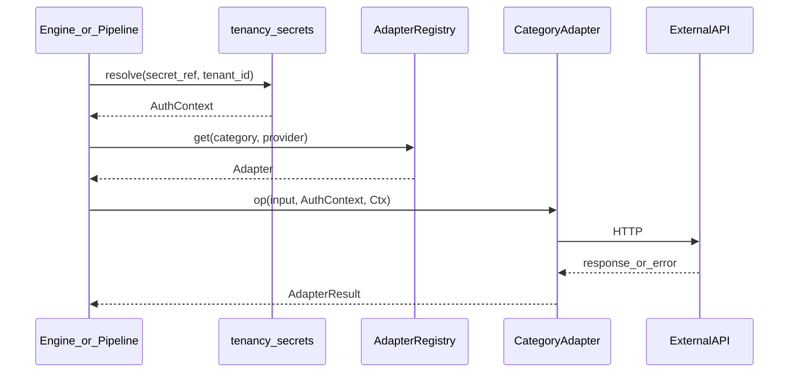

# Phase 4 — Adaptateurs

**Produit :** Kanso Solutions (shbt studio SAS)  
**Date :** 2026-10-10  
**Statut :** validé (2026-10-10)  
**Prérequis :** [phase-3-moteur-inbound.md](./phase-3-moteur-inbound.md), [phase-2-configuration-client.md](./phase-2-configuration-client.md)

## Objectif

Définir les contrats d’interface communs (CRM, agenda, alertes, sources documents, outils comptables / cibles), la gestion des erreurs, retries et rate limits, et ordonner les **2 premiers connecteurs** de chaque catégorie pour la grille TPE/PME FR.

## Décisions retenues

| Sujet | Choix | Source |
|-------|--------|--------|
| Forme du contrat | Interfaces TS par catégorie + résultat `ok \| retryable \| fatal` | Q1 = 1 (recommandé) |
| Retry | Exponentiel borné (3 essais) puis dead letter / anomalie | Q2 = 1 |
| Priorité connecteurs | Grille TPE/PME FR (ci-dessous) | Q3 = 1 |
| Secrets | Résolution `secret_ref` hors adaptateur ; client auth injecté | Q4 = 1 |
| Rate limit | Par `tenant_id` + provider | Q5 = 2 |

## Architecture d’appel



Règles :

1. Aucun adaptateur ne lit Vault / env lui-même.
2. `AdapterRegistry` mappe `provider` string (config) → implémentation.
3. Toute écriture externe est **idempotente** quand le provider le permet (`Idempotency-Key` ou clé métier) — *hypothèse à vérifier* par API.
4. Engagement = **tentative + journal** ; pas de « sync garantie ».

## Résultat commun

```text
AdapterResult<T> =
  | { status: "ok"; data: T; provider_request_id?: string }
  | { status: "retryable"; error_code: string; message: string; retry_after_ms?: number }
  | { status: "fatal"; error_code: string; message: string }

AdapterContext = {
  tenant_id: string
  correlation_id: string      // session_id ou job_id
  config_version: number
  attempt: number             // 1..max_attempts
}
```

Classification minimale des erreurs HTTP (*hypothèse* — affiner par provider) :

| Signal | status |
|--------|--------|
| 408, 429, 500–504, réseau | `retryable` |
| 401, 403 (après auth valide côté Kanso) | `fatal` (secret/permissions) |
| 400, 404, 422 métier | `fatal` (payload) sauf cas documentés retryable |

## Retry

| Paramètre | Valeur MVP |
|-----------|------------|
| `max_attempts` | 3 |
| Backoff | exponentiel : base 1s, facteur 2, jitter ±20% (*hypothèse*) |
| Respect `retry_after_ms` / header `Retry-After` | oui si présent |
| Après échec | Inbound → `ClosedDegraded` + log ; Document-to-Action → file anomalies (phase 5) |
| Dead letter | table `adapter_dead_letters` (tenant_id, category, payload ref, last_error) |

Pas de retry infini. Pas de retry sur `fatal`.

## Rate limiting

- Clé : `(tenant_id, provider)`.
- Compteur / fenêtre en Postgres (pas Redis) — *hypothèse H-017* : fenêtre glissante 1 minute suffisante.
- Défauts globaux par provider (overridable plus tard) ; si dépassé → `retryable` avec `retry_after_ms`.
- Un tenant ne doit pas épuiser le quota d’un autre (clés séparées).

Quotas numériques exacts = *hypothèse à vérifier* selon plans API des providers choisis.

## Secrets / AuthContext

```text
AuthContext = {
  provider: string
  tenant_id: string
  credentials: opaque  // token, api_key, refresh — jamais loggé en clair
}
```

Résolu par `@kanso/tenancy` depuis `secret_ref` avant l’appel.

---

## Contrats par catégorie

### 1. Alertes — `AlertAdapter`

```text
send(input: {
  channel: "email" | "slack"
  event: "new_lead" | "hot_lead" | "escalation" | "handoff"
       | "low_confidence" | "validation_failed" | "duplicate_suspected"
  title: string
  body: string
  metadata: Record<string, string | number | boolean>
}, auth, ctx) -> AdapterResult<{ delivered: true }>
```

### 2. CRM — `CrmAdapter`

```text
upsertLead(input: {
  external_key: string          // ex. session_id — idempotence
  contact: { email?: string; phone?: string; name?: string }
  score_final?: number
  answers: Record<string, unknown>
  source: "kanso_inbound"
}, auth, ctx) -> AdapterResult<{ record_id: string }>
```

### 3. Agenda — `CalendarAdapter`

```text
listSlots(input: { from: string; to: string; timezone: string }, auth, ctx)
  -> AdapterResult<{ slots: { start: string; end: string }[] }>

bookSlot(input: {
  slot_start: string
  slot_end: string
  attendee_email: string
  title: string
  idempotency_key: string
}, auth, ctx) -> AdapterResult<{ event_id: string }>
```

MVP Inbound : n’appeler que si `integrations.calendar` présent (phase 2/3).  
*Hypothèse :* Calendly expose des slots via API utilisable sous ce contrat — à valider avant implémentation rang 2.

### 4. Sources documents — `DocumentSourceAdapter`

```text
poll(input: { cursor?: string }, auth, ctx)
  -> AdapterResult<{
       items: { source_item_id: string; filename?: string; content_type: string;
                payload_ref: string; received_at: string }[]
       next_cursor?: string
     }>

ack(input: { source_item_id: string }, auth, ctx)
  -> AdapterResult<{ acked: true }>
```

`upload_web` : pas de `poll` externe — l’API écrit directement un job (adaptateur « null source » ou bypass registry).

### 5. Cibles comptables / écriture — `AccountingTargetAdapter`

(Nom générique : couvre Pennylane, Sellsy facturation, etc.)

```text
createDraft(input: {
  document_type: "invoice" | "quote" | "delivery_note"
  fields: Record<string, unknown>   // déjà validés pipeline
  idempotency_key: string
  mode: "draft" | "final"           // MVP : draft par défaut
}, auth, ctx) -> AdapterResult<{ remote_id: string; mode: "draft" | "final" }>
```

---

## 2 premiers connecteurs par catégorie (ordre de développement)

Grille TPE/PME FR. Rang 1 = premier à implémenter ; rang 2 = suivant.

| Catégorie | Rang 1 | Rang 2 | Notes |
|-----------|--------|--------|-------|
| **Alertes** | `email` (SMTP ou API transactionnelle UE) | `slack` (incoming webhook ou Web API) | Couvre phase 2 obligatoire |
| **CRM** | `hubspot` | `sellsy` | Sellsy aussi cible compta : packages séparés, credentials séparés |
| **Agenda** | `google_calendar` | `calendly` | Uniquement si config `integrations.calendar` |
| **Sources documents** | `email_inbox` | `upload_web` | Drive/Dropbox après pilote |
| **Cibles écriture** | `pennylane` | `sellsy` | Mode `draft` par défaut |

### Hors rang 1–2 MVP (backlog explicite)

- Sources : `google_drive`, `dropbox`
- Cibles : `notion`, `webhook` générique
- CRM : Pipedrive, Salesforce, etc.
- Agenda : Outlook

### Ordre de chantier global suggéré (90 jours → phase 9)

1. Alertes `email` + `slack`  
2. Sources `email_inbox` + `upload_web`  
3. Cible `pennylane`  
4. CRM `hubspot`  
5. Agenda `google_calendar`  
6. Rang 2 restants (`sellsy` CRM/cible, `calendly`)

## Observabilité minimale

Chaque appel journalise (sans secrets) : `tenant_id`, `provider`, `category`, `op`, `status`, `attempt`, `duration_ms`, `correlation_id`, `provider_request_id`.  
Compteurs coût provider hors scope détaillé (phase 6).

## Hors périmètre

- Implémentation SDK / tests d’intégration réels (phase 7+)  
- Détail file d’anomalies Document-to-Action (phase 5)  
- DPA / localisation de chaque provider (phase 6 — *critique avant prod*)  

## Ce qui reste incertain

- Provider e-mail transactionnel exact (Brevo, Amazon SES eu, SMTP OVH…) sous budget + UE
- Capacité Calendly à mapper proprement `listSlots` / `bookSlot`
- Quotas API HubSpot / Pennylane / Sellsy sur plans TPE
- Idempotence réelle de chaque API d’écriture

## Risques

| Risque | Impact | Mitigation |
|--------|--------|------------|
| Surface 10 connecteurs | Dilution avant pilote | Respecter l’ordre global ; pilote peut n’en activer que 3–4 |
| Sellsy double casquette | Confusion credentials | Deux `provider` keys / secret_ref distincts |
| 429 mal gérés | Jobs bloqués | Rate limit tenant + Retry-After |
| Provider hors UE | Non-conformité discours RGPD | Checklist phase 6 avant activation prod |

## Question de validation

Ces contrats et cet ordre de connecteurs vous conviennent-ils ? Répondez **validé** pour ouvrir la phase 5 (pipeline Document-to-Action), ou indiquez les amendements.
