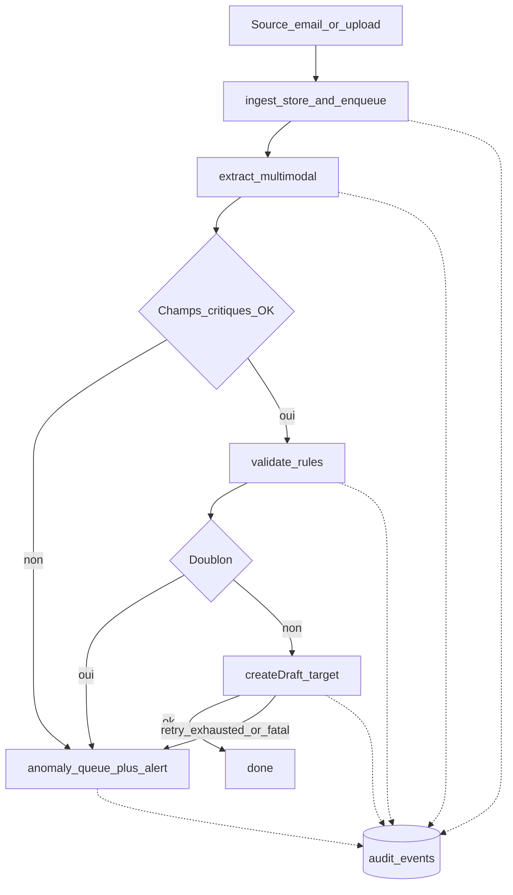

# Phase 5 — Pipeline Document-to-Action

**Produit :** Kanso Solutions (shbt studio SAS)  
**Date :** 2026-10-10  
**Statut :** validé (2026-10-10)  
**Prérequis :** [phase-2-configuration-client.md](./phase-2-configuration-client.md), [phase-4-adaptateurs.md](./phase-4-adaptateurs.md)

## Objectif

Spécifier le flux d’un document de l’ingestion à l’écriture cible (brouillon), avec file Postgres, confiance par champ, doublons, anomalies et audit — sans code (phase 7).

## Décisions retenues

| Sujet | Choix | Source |
|-------|--------|--------|
| Granularité job | 1 job = 1 document ; étapes = statuts | Q1 = 1 |
| Doublons | Clés métier config + hash SHA-256 fichier | Q2 = 1 |
| Confiance | Score **par champ** ; anomalie si champ critique &lt; seuil | Q3 = 2 |
| Résolution anomalies | Humain client (notif) ; statut via `admin-cli` Kanso au MVP | Q4 = 1 |
| Audit | Une entrée par transition d’étape + décision résumée | Q5 = 1 |

## Diagramme de flux



## Modèle de job (conceptuel)

```text
document_jobs
  id, tenant_id, config_version
  source_type, source_item_id
  storage_ref              -- objet Supabase Storage (fichier)
  content_sha256
  document_type            -- invoice|quote|delivery_note|null avant extract
  step                     -- ingest|extract|validate|act|anomaly|done
  status                   -- pending|running|succeeded|failed|waiting_human
  fields jsonb             -- valeurs extraites
  field_confidence jsonb   -- { field_id: number 0..1 }
  validation_results jsonb
  duplicate_of_job_id uuid null
  remote_id text null      -- id brouillon cible
  attempt_count int
  available_at timestamptz -- pour retry / rate limit
  last_error text null
  created_at, updated_at, closed_at
```

Worker : poll `status=pending AND available_at <= now()` FOR UPDATE SKIP LOCKED (*hypothèse* Postgres) ; un worker process sur l’instance OVH.

## Étapes

### 1. `ingest`

Entrées : poll `email_inbox` ou upload API.

Actions :

1. Stocker le binaire dans Storage (chemin `tenant_id/jobs/{id}/…`).
2. Calculer `content_sha256`.
3. Créer le job `step=ingest` → enchaîner `extract` (`status=pending`).
4. `ack` source si applicable (éviter re-livraison).
5. Audit `ingest.accepted`.

Échecs fatals (fichier illisible / trop volumineux) → `anomaly` + alerte.

### 2. `extract`

1. Appel LLM multimodal via `@kanso/llm` (provider abstrait) avec schéma de champs = `documents.fields_by_type` pour le type détecté ou demandé.
2. Sortie structurée validée Zod : `{ document_type, fields, field_confidence }`.
3. Champs absents → `null` + confiance basse, pas d’invention (*prompt + validation*).
4. Audit `extract.completed` (résumé champs, **pas** le fichier, **pas** le prompt complet en prod).

### 3. Contrôle confiance (avant validate métier)

Config : `alerts.human_review.min_confidence` (phase 2) + liste **champs critiques** par type (*hypothèse H-021* : défauts Kanso, ex. invoice → `total_ttc`, `invoice_number`, `iban` si présent dans fields_by_type).

Règle MVP :

- Si **un champ critique** a `field_confidence[field] < min_confidence` → `anomaly` raison `low_confidence`, alerte `low_confidence`, **pas** d’écriture cible.
- Les champs non critiques sous seuil : flaggés dans `validation_results` mais n’bloquent pas seuls (*hypothèse H-022*).

### 4. `validate`

Exécute `validation.rules[]` dans l’ordre config :

| kind | Comportement |
|------|----------------|
| `totals_coherent` | Vérifie HT/TVA/TTC selon tolérance |
| `duplicate_check` | Voir section Doublons |
| `iban_allowlist` | IBAN ∈ liste (secret_ref) si IBAN présent |
| `approval_threshold` | Si montant &gt; seuil → anomalie `needs_approval` (pas d’écriture auto) |
| `confidence_min` | Filet global optionnel en plus du contrôle par champ |

Échec règle bloquante → `anomaly` + alerte `validation_failed` (ou `duplicate_suspected`).

### 5. `act`

1. Vérifier `action.mode` : défaut / MVP **`draft`** ; `final` seulement si config + confirmation CLI historique (phase 2).
2. `AccountingTargetAdapter.createDraft` avec `idempotency_key = job_id` (ou dérivé stable).
3. Succès → `step=done`, `remote_id`, audit `act.draft_created`.
4. `retryable` → backoff phase 4, `available_at` futur, `attempt_count++`.
5. Épuisement / `fatal` → `anomaly` + alerte.

**Pas d’engagement de résultat comptable** : engagement = tentative d’écriture brouillon + audit + alerte si échec.

## Doublons

Deux signaux (l’un suffit à suspecter) :

1. **Hash** : même `tenant_id` + `content_sha256` qu’un job `done` ou `anomaly` récent (*fenêtre* : *hypothèse* 365 j ou durée conservation phase 6).
2. **Clés métier** : `duplicate_check.params.keys` — égalité normalisée (trim, case) sur jobs antérieurs du même `document_type`.

Comportement : ne pas écrire ; `duplicate_of_job_id` renseigné ; anomalie + alerte `duplicate_suspected`.  
L’idempotence provider reste une défense secondaire.

## File d’anomalies

```text
step = anomaly
status = waiting_human
last_error / validation_results = raison machine-readable
```

Notification client via `AlertAdapter` (e-mail/Slack) : résumé, `job_id`, raison, **pas** de pièce jointe automatique contenant des données bancaires en clair si évitable (*hypothèse* : lien sécurisé ou ticket texte).

Résolution MVP :

1. Client décide (corriger dans Pennylane, ignorer, renvoyer doc).
2. Associé Kanso : `admin-cli anomaly resolve --job <id> --action discard|requeue_extract|mark_done`.
3. Pas de back-office client au MVP (aligné phases 2/4).

## Journal d’audit

```text
audit_events
  id, tenant_id, job_id, at
  step, decision        -- accepted|extracted|blocked|draft_created|alerted|resolved
  summary jsonb         -- champs non sensibles, scores, rule_ids, remote_id
  actor                 -- system|admin_cli|adapter
  correlation_id
```

Règles :

- Une entrée **par transition** d’étape / décision majeure.
- Pas de binaire document, pas de secrets, pas de prompt LLM complet en prod.
- Mode debug local peut logger plus — interdit en `prod` par défaut.

## Mode brouillon

| Mode | Comportement |
|------|----------------|
| `draft` (défaut) | `createDraft` ; humain valide dans l’outil cible |
| `final` | Refusé par le worker sauf config explicite + secret de feature process Kanso (*garde-fou*) |

## Liens config (rappel)

Sources, types, règles, cible, `min_confidence`, canaux d’alerte = config `document_to_action` phase 2.  
Conservation fichiers / audit = politique globale phase 6 (hors config tenant).

## Hors périmètre

- Choix du modèle multimodal concret (abstraction + phase 8)  
- UI de résolution client  
- Drive/Dropbox (backlog phase 4)  
- Checklist RGPD détaillée (phase 6)  

## Ce qui reste incertain

- Liste exacte des champs critiques par `document_type` (défauts H-021)
- Fenêtre de dédoublonnage vs durée de conservation
- Contenu exact de la notification (lien vs texte) sous contrainte sécurité
- Throughput worker unique OVH (N jobs/min) — *hypothèse* suffisant pré-pilote

## Risques

| Risque | Impact | Mitigation |
|--------|--------|------------|
| Faux positifs doublons | Anomalies inutiles | Normalisation clés + revue CLI `requeue` |
| Faux négatifs confiance | Mauvais brouillon | Champs critiques stricts ; draft only |
| Anomalies sans suivi client | File qui grossit | Alerte + process commercial « revue quotidienne » |
| Coût LLM extraction | Budget tokens | Phase 8 métrique €/doc ; modèle économique hors infra 50 € |

## Question de validation

Ce pipeline (étapes, doublons, confiance par champ, anomalies, audit) vous convient-il ? Répondez **validé** pour ouvrir la phase 6 (sécurité, RGPD, exploitation), ou indiquez les amendements.
