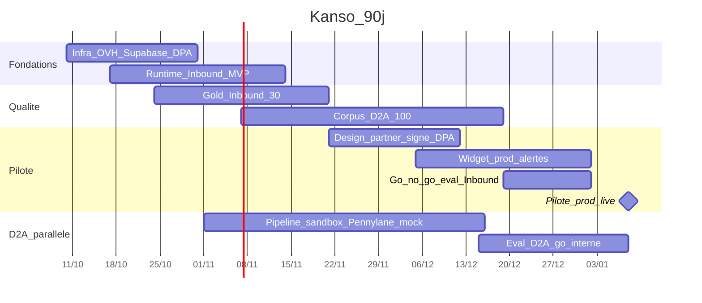

# Phase 9 — Plan de livraison (90 jours)

**Produit :** Kanso Solutions (shbt studio SAS)  
**Date :** 2026-10-10  
**Statut :** validé (2026-10-10) — cadrage phases 0–9 clos  
**Fenêtre :** 2026-10-10 → 2027-01-08 (J+90)  
**Prérequis :** phases 0–8 validées ; squelette code phase 7

## Objectif

Ordonner le développement, jalonner 90 jours, assigner les rôles des 4 associés et figer les critères de passage en production du premier pilote (design partner).

## Décisions retenues

| Sujet | Choix | Source |
|-------|--------|--------|
| Priorité produit | Inbound d’abord ; D2A en parallèle non bloquant | Q1 = 1 |
| Rôles | A moteurs · B adaptateurs/infra · C éval/données · D commercial/legal/ops | Q2 = 1 |
| Cible pilote prod | J+90 (~2027-01-08) | Q3 = 2 |
| Connecteurs pilote Inbound | Alertes e-mail (+ Slack si prêt) ; CRM/agenda non obligatoires | Q4 = 1 |
| D2A pendant les 90 j | Sandbox + corpus/eval ; pas bloquant pour widget prod | Q4 + Q1 |
| Entrée pilote | Design partner sous DPA, puis conversion devis | Q5 = 2 |

Mapper dès que possible les **prénoms** sur A/B/C/D (hors décision technique).

---

## 1. Rôles (ownership)

| Rôle | Scope | Backup |
|------|--------|--------|
| **A — Tech moteurs** | `inbound-engine`, `inbound-api`, widget, sessions, prompts, garde-fous | B |
| **B — Adaptateurs / infra** | OVH, Supabase, secrets, alert adapters, CI/CD minimal, health/Grafana Free | A |
| **C — Éval / qualité / données** | Gold set 30 conv + ≥100 docs, runs eval, anonymisation, métriques, soft caps proposés | A |
| **D — Commercial / legal / ops** | Design partner, DPA, textes moyens (pas de résultat garanti), disclaimer IA, onboarding brief, rota incident 7j/7 9–18 | B/C |

Règle : tout changement LLM-facing = binôme **A+C** avant merge.

---

## 2. Jalons (calendrier)

| Jalon | Date cible | Critère de done |
|-------|------------|-----------------|
| **M0** Cadrage clos | 2026-10-10 | Phases 0–9 validées |
| **M1** Fondations live | 2026-10-31 | Projet Supabase UE + VPS OVH + secrets + `/health` prod + Grafana Free ou repli |
| **M2** Inbound MVP technique | 2026-11-14 | Machine à états hybride live, sessions Postgres, alerte e-mail, disclaimer IA |
| **M3** Gold Inbound prêt | 2026-11-21 | 30 cas + première run eval (même partielle) |
| **M4** Design partner | 2026-12-12 | DPA signé + brief config + `tenant` draft |
| **M5** Go/no-go Inbound | 2026-12-31 | Seuils phase 8 Inbound verts (policy 100 %, hallucinations 0, états ≥90 %) |
| **M6** Pilote prod | **2027-01-08** | Checklist §5 + widget sur site partenaire + alertes ops |
| **M7** D2A sandbox (non bloquant) | 2027-01-08 | ≥100 docs labellisés et/ou pipeline draft mock/sandbox ; seuils D2A = objectif stretch |

Glissement : si M4 sans partenaire au 12/12, basculer sur **tenant démo interne** pour M5–M6 techniques, et reporter « données client réelles » — pas de prod données tiers sans DPA.

---

## 3. Backlog priorisé (P0 → P3)

### P0 — Bloquant pilote Inbound (dans les 90 j)

| ID | Item | Rôle | Depends |
|----|------|------|---------|
| P0-01 | Appliquer migrations Supabase + RLS `tenant_id` | B | — |
| P0-02 | Provision OVH + Docker api/worker + env prod | B | — |
| P0-03 | Secret store tenant (Vault/colonne) + `admin-cli` put-secret | B | P0-01 |
| P0-04 | Runtime session Postgres + TTL | A | P0-01 |
| P0-05 | Orchestration états hybride + validation sortie LLM | A | P0-04 |
| P0-06 | Provider LLM abstrait (1 provider UE-friendly pour pilote) | A | — |
| P0-07 | `AlertAdapter` e-mail (provider UE à choisir — H-019) | B | P0-03 |
| P0-08 | Widget JS marque blanche minimal + disclaimer | A | P0-05 |
| P0-09 | `usage_ledger` + soft cap alerte interne | B/C | P0-06 |
| P0-10 | Purge retention 90/90/365/30 | B | P0-01 |
| P0-11 | 30 cas eval Inbound + runner | C | P0-05 |
| P0-12 | Run go/no-go Inbound | A+C | P0-11 |
| P0-13 | DPA templates + registre traitements + textes moyens | D | — |
| P0-14 | Design partner : brief, config publish CLI, smoke | D+A | P0-08, P0-13 |
| P0-15 | Runbooks incident + rota 7j/7 9–18 | D+B | M1 |
| P0-16 | Checklist pilote §5 signée associés | Tous | M5 |

### P1 — Fortement souhaitable dans les 90 j

| ID | Item | Rôle |
|----|------|------|
| P1-01 | AlertAdapter Slack | B |
| P1-02 | Hors-horaires flag + message | A |
| P1-03 | Grafana Free dashboards santé/jobs/coûts | B |
| P1-04 | Corpus D2A ≥100 + labels | C |
| P1-05 | Pipeline D2A extract→validate→draft mock/sandbox | A |
| P1-06 | Eval D2A run (même si seuils non atteints) | C |
| P1-07 | Staging allégé au moment du pilote (D-014) | B |

### P2 — Après premier pilote stable

| ID | Item |
|----|------|
| P2-01 | HubSpot CRM adapter |
| P2-02 | Google Calendar adapter |
| P2-03 | Pennylane draft réel + `email_inbox` |
| P2-04 | Sellsy (CRM ou cible) rang 2 |
| P2-05 | Calendly |
| P2-06 | Back-office client (toujours hors MVP historique) |

### P3 — Plus tard

| ID | Item |
|----|------|
| P3-01 | RAG Inbound (D-034) |
| P3-02 | Drive / Dropbox sources |
| P3-03 | Mode `final` écriture comptable |
| P3-04 | HA / 2e instance |

---

## 4. Ordre de développement (séquences)

**Voie Inbound (critique)**  
P0-01 → P0-02 → P0-03 → P0-04 → P0-05 → P0-06 → P0-07 → P0-08 → P0-11 → P0-12 → P0-14 → P0-16

**Voie conformité (parallèle dès J0)**  
P0-13 → P0-15 → (validation juridique H-025)

**Voie D2A (parallèle, non bloquante)**  
P1-04 en parallèle de P1-05 → P1-06

**Infra transverse**  
P0-09, P0-10, P1-03 en continu après M1

---

## 5. Critères de passage en production — premier pilote

Tous obligatoires :

### Produit / technique

- [ ] Tenant `active` avec config Inbound `published` validée Zod  
- [ ] Disclaimer IA visible au premier message  
- [ ] Garde-fous A/B/C (phase 3) actifs  
- [ ] Alerte e-mail opérationnelle (Slack optionnel)  
- [ ] Eval Inbound phase 8 : policy refuse 100 %, hallucinations 0, terminal_state ≥ 90 %  
- [ ] `/health` + heartbeat worker (même si worker D2A idle)  
- [ ] `usage_ledger` actif ; soft cap défini (H-027/H-031)  

### Sécurité / RGPD

- [ ] DPA design partner signé  
- [ ] DPA sous-traitants critiques (OVH, Supabase, LLM, e-mail, ± Grafana)  
- [ ] Isolation `tenant_id` + test cross-tenant  
- [ ] Purge retention planifiée  
- [ ] Pas d’engagement de résultat dans le devis / DPA / UI  

### Ops

- [ ] Rota incident 7j/7 9–18 Europe/Paris nommée  
- [ ] Runbook S1/S2 accessible  
- [ ] Smoke : 1 conversation réelle de test + réception alerte  

**Hors critères pilote Inbound :** CRM, agenda, seuils D2A 85/15, 200 docs.

---

## 6. Risques planning

| Risque | Impact | Mitigation |
|--------|--------|------------|
| Pas de design partner à M4 | Retard apprentissage réel | Tenant démo ; chase commerciale D |
| Budget infra &lt; 50 € dépassé | Coupe service | 1 VPS ; Grafana Free only ; alertes coût |
| Eval Inbound sous seuils à M5 | Slip pilote | Buffer 1–2 sem prompts ; pas d’élargir scope connecteurs |
| Charge D2A vole du temps Inbound | Raté M6 | D2A = P1 ; freeze scope si glissement |
| DPA LLM UE non clair | Blocage conformité | Préférer endpoint EU (ex. Mistral) pour pilote — *à vérifier* |

---

## 7. Livrables documentaires déjà en place

| Phase | Fichier |
|-------|---------|
| 0 | [phase-0-cadrage.md](./phase-0-cadrage.md) |
| 1 | [phase-1-structure-depot.md](./phase-1-structure-depot.md) |
| 2 | [phase-2-configuration-client.md](./phase-2-configuration-client.md) |
| 3 | [phase-3-moteur-inbound.md](./phase-3-moteur-inbound.md) |
| 4 | [phase-4-adaptateurs.md](./phase-4-adaptateurs.md) |
| 5 | [phase-5-pipeline-document-to-action.md](./phase-5-pipeline-document-to-action.md) |
| 6 | [phase-6-securite-rgpd-exploitation.md](./phase-6-securite-rgpd-exploitation.md) |
| 7 | [phase-7-squelette-code.md](./phase-7-squelette-code.md) |
| 8 | [phase-8-evaluation.md](./phase-8-evaluation.md) |
| Journal | [DECISIONS.md](../DECISIONS.md) |

---

## Ce qui reste incertain

- Noms des associés sur A/B/C/D  
- Soft caps € exacts  
- Identité du design partner  
- Provider e-mail transactionnel final  

## Risques

Voir §6. Principal : **scope creep D2A/connecteurs** avant M6.

## Question de validation

Ce plan 90 jours (Inbound first, pilote J+90, design partner, backlog P0–P3) vous convient-il ? Répondez **validé** pour clôturer le cadrage phases 0–9, ou indiquez les amendements.
